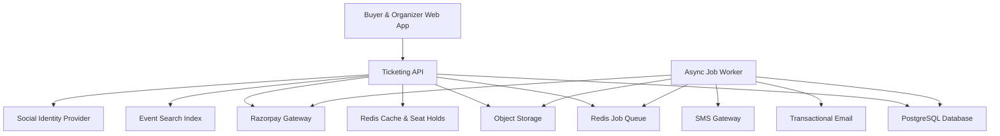
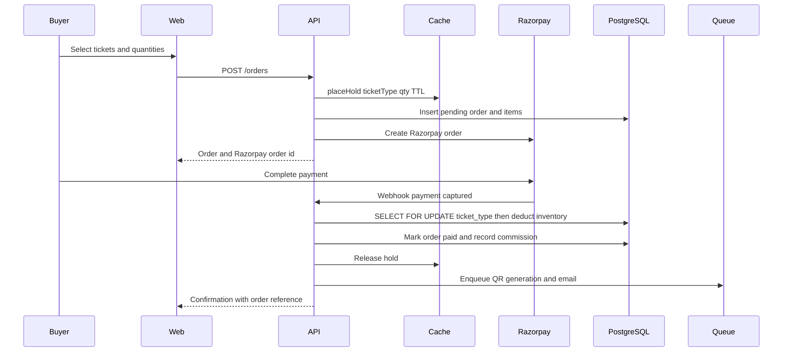
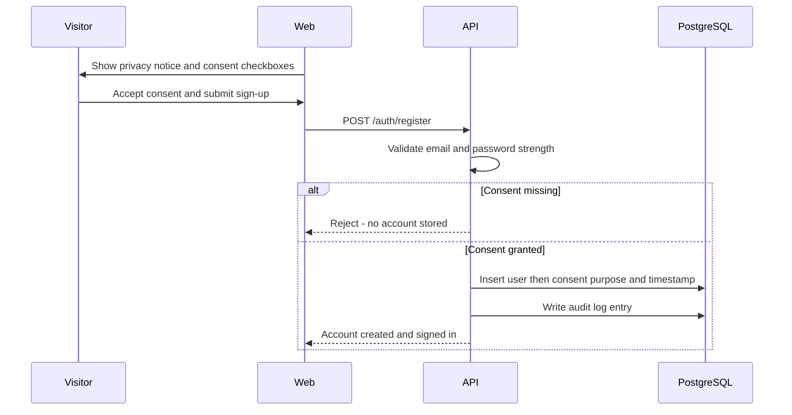
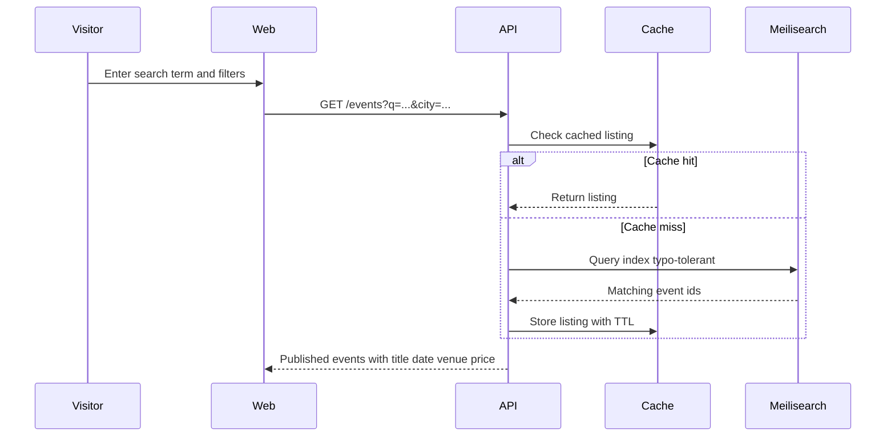
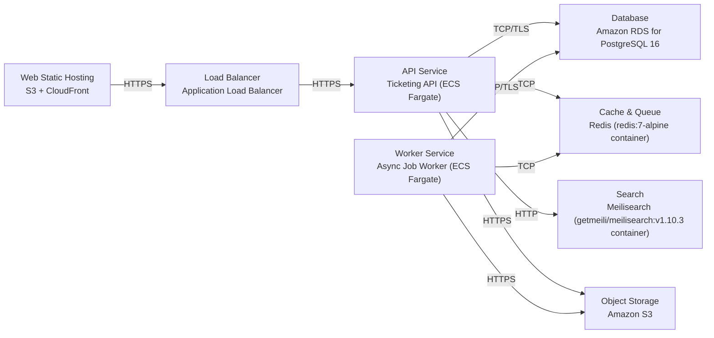

# Architecture

> Maintained by QuorQ AI SDLC. Text between `sdlc:auto` markers is regenerated; anything outside them is yours and is kept.

<!-- sdlc:auto:start narrative -->
## Overview

### ARCH-OVERVIEW · approved · source: architecture:summary

Approved v1 architecture for a React 19 + Spring Boot 4.1 event-ticketing platform hosted on AWS ap-south-1, using PostgreSQL as system of record, Redis for holds and job queueing, Meilisearch for discovery, Razorpay for payments, and SendGrid/MSG91 for notifications, with DPDP-compliant data residency in India.

Architecture document version 1, status approved. Covers 12 components, 3 critical paths, 9 data entities, 20 API endpoints, 8 deployment nodes, and 4 core technology decisions. Core guarantee: PostgreSQL row-level locking ensures each ticket is sold exactly once under concurrent demand (NFR-001); QR generation and notifications run asynchronously via a Redis-backed queue so bookings confirm instantly. Public browsing/search is served from Meilisearch and Redis cache to keep load off the main database (NFR-002). DPDP consent is captured at signup and is withdrawable (NFR-009); all personal and payment data is kept in India via AWS Mumbai / ap-south-1 (NFR-008). The frontend is built with phone-usable layouts (NFR-011, NFR-012).

**Related:** NFR-001, NFR-002, NFR-008, NFR-009, NFR-011, NFR-012

- ⚠ Architecture input does not explicitly map components/endpoints to individual US-001..US-023 requirement ids; only NFR-001, NFR-002, NFR-008, NFR-009, NFR-011, NFR-012 are referenced by id in the source, so full requirement-to-architecture traceability should be confirmed manually.
- ⚠ No date is recorded for when this architecture version was approved or by whom.

### ARCH-COMP-WEB · approved · source: architecture:component-web

Responsive React 19 single-page application serving both buyers and organizers.

Handles registration, DPDP consent capture, event browsing/search, organizer event management, checkout, and QR ticket display. Built with phone-usable, responsive layouts to support mobile booking and ticket display. Deployed as a static build to S3 + CloudFront.

**Related:** NFR-011, NFR-012, ARCH-DEPLOYMENT

### ARCH-COMP-API · approved · source: architecture:component-api

Spring Boot 4.1 service providing authentication, event/ticket management, order creation, and payment orchestration.

Handles auth, event/ticket-type CRUD, publishing, order creation with inventory locking, Razorpay payment orchestration, consent records, organizer dashboards, and ownership authorization. Deployed on ECS Fargate running JVM 21.

**Related:** NFR-001, ARCH-DEPLOYMENT, ARCH-CP-BOOKING

### ARCH-COMP-WORKER · approved · source: architecture:component-worker

Async job worker that offloads QR generation and notifications from the booking path.

Consumes Redis queue jobs to generate QR tickets into S3, send confirmation emails/SMS, and process organizer payout batches, so bookings confirm instantly without waiting on this work. Shares the Spring Boot 4.1 codebase with the API but is deployed as a separate ECS Fargate service (JVM 21).

**Related:** ARCH-COMP-QUEUE, ARCH-CP-BOOKING, ARCH-DEPLOYMENT

### ARCH-COMP-DB · approved · source: architecture:component-db

PostgreSQL 16 is the system of record for all core entities, with row-level locking to prevent overselling.

Stores users, consents, events, ticket types, orders, tickets, and audit logs. SELECT FOR UPDATE row-level locking on ticket_types guarantees exactly-once ticket sales under concurrent demand. Hosted in AWS Mumbai region for DPDP/RBI data residency.

**Related:** NFR-001, NFR-008, ARCH-DATA-MODEL, ARCH-TECH-DB

### ARCH-COMP-CACHE · approved · source: architecture:component-cache

Redis cache holds short-lived ticket reservations during checkout and caches hot public event listings.

Implements TTL-based holds during checkout to reserve inventory while payment is pending, preventing overselling, and caches frequently accessed public event listings to reduce load on PostgreSQL. Runs as a redis:7-alpine container.

**Related:** NFR-002, ARCH-CP-BOOKING, ARCH-CP-DISCOVERY

### ARCH-COMP-QUEUE · approved · source: architecture:component-queue

Redis-backed job queue decouples slow post-booking work from the booking transaction.

Carries jobs for QR generation, notifications, and organizer payout batches, consumed by the Async Job Worker, so the booking path confirms instantly without waiting on these tasks. Runs as a redis:7-alpine container, logically separate from the seat-hold cache.

**Related:** ARCH-COMP-WORKER, ARCH-CP-BOOKING

### ARCH-COMP-SEARCH · approved · source: architecture:component-search

Meilisearch provides typo-tolerant public event search and filtering.

Indexes published events for search and filtering by city, date, and category, kept off the main database to insulate it from public browsing traffic. Publishing an event syncs it into the index; unpublishing removes it from public results. Runs getmeili/meilisearch:v1.10.3.

**Related:** NFR-002, ARCH-CP-DISCOVERY

### ARCH-COMP-OBJSTORE · approved · source: architecture:component-objstore

Amazon S3 stores event banners, venue seat-map assets, and generated QR ticket images.

Durable object storage located in the Mumbai region, used by the web app for banners/seat-maps and by the async worker for generated QR ticket images.

**Related:** NFR-008, ARCH-COMP-WORKER, ARCH-DEPLOYMENT

### ARCH-COMP-PAYMENTS · approved · source: architecture:component-payments

Razorpay gateway collects buyer payments, deducts commission, and pays organizers.

Collects buyer payments in India, deducts per-ticket commission, verifies webhooks, and pays organizers via RazorpayX transfers. Webhook confirmation triggers order confirmation and inventory deduction under a PostgreSQL row lock.

**Related:** NFR-001, ARCH-CP-BOOKING, ARCH-API-ORDERS

### ARCH-COMP-EMAIL · approved · source: architecture:component-email

SendGrid sends transactional booking confirmations and notifications.

Sends booking confirmations with QR tickets to buyers and notifications to organizers/admins, with delivery tracking.

**Related:** ARCH-COMP-WORKER

### ARCH-COMP-SMS · approved · source: architecture:component-sms

MSG91 provides optional DLT-registered SMS for Indian buyers.

Sends booking confirmations and gate-entry details via SMS as an optional channel alongside email, using DLT-registered templates required for Indian SMS traffic.

**Related:** ARCH-COMP-WORKER, NFR-008

### ARCH-COMP-AUTH · approved · source: architecture:component-auth

Google OAuth provides social sign-in/sign-up alongside email/password.

Allows buyers and organizers to register/sign in via Google OAuth in addition to email/password; DPDP consent is captured on first use of OAuth sign-in, the same as the email/password path.

**Related:** NFR-009, ARCH-CP-CONSENT

### ARCH-CP-BOOKING · approved · source: architecture:critical-path-booking

Concurrent ticket booking and payment flow guarantees exactly-once ticket sales.

Buyer selects ticket quantities; a Redis hold reserves inventory for checkout; Razorpay collects payment; on webhook confirmation, PostgreSQL deducts inventory under a row lock so each ticket is sold exactly once. Failed or abandoned payments release the hold. This path addresses NFR-001.

**Related:** NFR-001, ARCH-COMP-CACHE, ARCH-COMP-DB, ARCH-COMP-PAYMENTS, ARCH-COMP-WORKER, ARCH-API-ORDERS

### ARCH-CP-CONSENT · approved · source: architecture:critical-path-consent

DPDP consent capture gates account creation at signup.

Buyer or organizer is shown the privacy notice and must grant explicit consent before any personal data is persisted. Consent purpose and timestamp are recorded; refusal blocks account creation. This path addresses NFR-009.

**Related:** NFR-009, ARCH-COMP-AUTH, ARCH-API-CONSENT, ARCH-DATA-MODEL

### ARCH-CP-DISCOVERY · approved · source: architecture:critical-path-discovery

Public event discovery is served from cache and search index rather than the main database.

Visitors browse and search published events via Meilisearch and Redis-cached listings, keeping sales traffic off the main database. Publishing an event syncs it into the search index. This path addresses NFR-002.

**Related:** NFR-002, ARCH-COMP-SEARCH, ARCH-COMP-CACHE, ARCH-API-PUBLIC

### ARCH-DATA-MODEL · approved · source: architecture:entities

PostgreSQL schema covers users, consents, events, ticketing, orders, and audit logging.

- users: id, email, password_hash, role, display_name, auth_provider, created_at
- consents: id, user_id, purpose, granted, granted_at, withdrawn_at
- password_reset_tokens: id, user_id, token_hash, expires_at, used_at
- events: id, organizer_id, title, description, venue, city, starts_at, status, banner_url, created_at
- ticket_types: id, event_id, name, price, total_quantity, sold_quantity
- orders: id, buyer_id, event_id, order_reference, status, total_amount, commission_amount, razorpay_order_id, razorpay_payment_id, created_at, paid_at
- order_items: id, order_id, ticket_type_id, quantity, unit_price
- tickets: id, order_item_id, event_id, qr_identifier, qr_image_url, status
- audit_logs: id, user_id, action, resource, ip_address, created_at

**Related:** ARCH-COMP-DB, ARCH-CP-BOOKING, ARCH-CP-CONSENT, NFR-001, NFR-009

- ⚠ No explicit foreign-key/index/constraint details are given beyond the row-level locking behavior on ticket_types.

### ARCH-API-AUTH · approved · source: architecture:endpoints-auth

Authentication and password-reset endpoints for email/password and Google OAuth.

- POST /auth/register: register buyer or organizer with email/password after required consent; rejects duplicate email, weak password, or missing consent.
- POST /auth/login: authenticate with email/password; generic error on failure (no enumeration).
- POST /auth/logout: end the current session.
- GET /auth/oauth/google: begin Google OAuth sign-in/sign-up; captures consent on first use.
- POST /auth/password-reset/request: send a time-limited reset link; neutral confirmation regardless of email existence.
- POST /auth/password-reset/confirm: set a new password using a valid single-use token.

**Related:** ARCH-COMP-API, ARCH-COMP-AUTH, NFR-009

### ARCH-API-CONSENT · approved · source: architecture:endpoints-consent

Endpoints for viewing and withdrawing DPDP consent.

- GET /me/consents: view current consent records.
- POST /me/consents/withdraw: withdraw consent for a purpose and record the withdrawal; returns what stops and what is lawfully retained.

**Related:** NFR-009, ARCH-CP-CONSENT, ARCH-DATA-MODEL

### ARCH-API-EVENTS · approved · source: architecture:endpoints-events

Organizer-owned endpoints for creating, editing, and publishing events and ticket types.

- POST /events: create an event draft owned by the organizer; rejects missing fields or past date/time.
- PUT /events/{id}: edit an owned event; owner-only.
- POST /events/{id}/ticket-types: add a general-admission ticket type with non-negative price and positive quantity.
- PUT /events/{id}/ticket-types/{ttId}: edit a ticket type; quantity cannot drop below sold_quantity.
- POST /events/{id}/publish: publish a complete draft (indexes it for search); blocks with a missing-field list if incomplete.
- POST /events/{id}/unpublish: remove from public browsing and stop new bookings; existing bookings stay valid.

**Related:** ARCH-COMP-API, ARCH-COMP-SEARCH, ARCH-CP-DISCOVERY

### ARCH-API-PUBLIC · approved · source: architecture:endpoints-public

Public, unauthenticated endpoints for browsing and viewing published events.

- GET /events: public listing/search of published events by term, city, date, category; excludes drafts and past events.
- GET /events/{id}: public event detail with ticket types and availability; unpublished events are not accessible.

**Related:** NFR-002, ARCH-COMP-SEARCH, ARCH-CP-DISCOVERY

### ARCH-API-ORDERS · approved · source: architecture:endpoints-orders

Order creation, payment webhook, and buyer-facing order/ticket retrieval.

- POST /orders: create a pending order for selected ticket types within availability; places Redis holds.
- POST /payments/webhook: Razorpay webhook verifies signature, confirms order under row lock, deducts inventory, records commission, enqueues QR/email.
- GET /me/orders: buyer's own orders with status and references.
- GET /me/tickets: buyer's QR tickets for confirmed paid orders only.

**Related:** NFR-001, ARCH-CP-BOOKING, ARCH-COMP-PAYMENTS, ARCH-COMP-CACHE, ARCH-COMP-DB

### ARCH-API-ORGANIZER · approved · source: architecture:endpoints-organizer

Owner-only reporting endpoints for organizers to view sales and attendees.

- GET /organizer/events/{id}/sales: owner-only sales counts -- sold, remaining, gross revenue from confirmed orders.
- GET /organizer/events/{id}/attendees: owner-only attendee list from confirmed orders with empty state.

**Related:** ARCH-COMP-API, ARCH-COMP-DB

### ARCH-DEPLOYMENT · approved · source: architecture:deployment-nodes

Deployment topology runs on AWS ap-south-1 using managed and containerized services behind an ALB.

- Web Static Hosting: React 19 static build served via S3 + CloudFront.
- API Service: Ticketing API on ECS Fargate, Spring Boot 4.1 on JVM 21.
- Worker Service: Async Job Worker on ECS Fargate, Spring Boot 4.1 on JVM 21.
- Database: Amazon RDS for PostgreSQL 16.
- Cache & Queue: Redis 7 (redis:7-alpine container).
- Search: Meilisearch v1.10.3 (getmeili/meilisearch:v1.10.3 container).
- Object Storage: Amazon S3.
- Load Balancer: Application Load Balancer in front of the API/worker services.

**Related:** NFR-008, ARCH-COMP-WEB, ARCH-COMP-API, ARCH-COMP-WORKER, ARCH-COMP-DB, ARCH-COMP-CACHE, ARCH-COMP-QUEUE, ARCH-COMP-SEARCH, ARCH-COMP-OBJSTORE

- ⚠ No details given on autoscaling policy, multi-AZ setup, networking/VPC layout, or disaster-recovery plan for this deployment.

### ARCH-TECH-FRONTEND · approved · source: architecture:tech-decision-frontend

React 19 chosen for the frontend over Angular and Vue.

Delivered as a responsive React 19 SPA served from S3/CloudFront, meeting phone-usable browsing, booking, and QR-display requirements (NFR-011, NFR-012). Alternatives considered: Angular, Vue.

**Related:** NFR-011, NFR-012, ARCH-COMP-WEB

### ARCH-TECH-BACKEND · approved · source: architecture:tech-decision-backend

Spring Boot 4.1 chosen for the backend over Express and FastAPI.

A single Spring Boot 4.1 codebase runs both the synchronous API and the async worker, using JPA transactions and pessimistic row locks to guarantee exactly-once ticket sales (NFR-001). Alternatives considered: Express, FastAPI.

**Related:** NFR-001, ARCH-COMP-API, ARCH-COMP-WORKER

### ARCH-TECH-DB · approved · source: architecture:tech-decision-database

PostgreSQL 16 chosen for the database over MySQL and DynamoDB.

PostgreSQL 16 holds users, consents, events, inventory, and orders; SELECT FOR UPDATE on ticket_types prevents overselling, and the same database produces organizer sales/revenue reporting. Alternatives considered: MySQL, DynamoDB.

**Related:** NFR-001, ARCH-COMP-DB

### ARCH-TECH-CLOUD · approved · source: architecture:tech-decision-cloud

AWS (Mumbai / ap-south-1) chosen for cloud hosting over Azure and GCP.

AWS Mumbai keeps all personal and payment data in India for DPDP/RBI residency (NFR-008) and provides RDS PostgreSQL, S3, and ALB from one provider in one country. Alternatives considered: Azure, GCP.

**Related:** NFR-008, ARCH-DEPLOYMENT
<!-- sdlc:auto:end narrative -->

<!-- sdlc:auto:start building-blocks -->
## Building Block View

| ID | Name | Technology | Responsibility | Depends on |
|---|---|---|---|---|
| web | Buyer & Organizer Web App | React 19 | Responsive SPA for registration, consent capture, event browsing/search, event management, checkout, and QR ticket display; phone-usable layouts. | api |
| api | Ticketing API | Spring Boot 4.1 | Auth, event/ticket-type CRUD, publishing, order creation with inventory locking, Razorpay payment orchestration, consent records, dashboards, and ownership authorization. | db, cache, queue, search, objstore, payments, auth |
| worker | Async Job Worker | Spring Boot 4.1 | Consumes Redis queue jobs to generate QR tickets into S3, send confirmation emails/SMS, and process organizer payout batches, so bookings confirm instantly. | db, queue, objstore, email, sms, payments |
| db | PostgreSQL Database | PostgreSQL 16 | System of record for users, consents, events, ticket types, orders, tickets, and audit logs; row-level locking prevents overselling. Stored in Mumbai for DPDP/RBI residency. | — |
| cache | Redis Cache & Seat Holds | Redis (redis:7-alpine) | Holds short-lived ticket holds during checkout with TTL expiry and caches hot public event listings. | — |
| queue | Redis Job Queue | Redis (redis:7-alpine) | Durable-enough job queue for QR generation, notifications, and payout batches, decoupling slow work from booking confirmation. | — |
| search | Event Search Index | Meilisearch (getmeili/meilisearch:v1.10.3) | Typo-tolerant public event search and filtering by city, date, and category, kept off the main database. | — |
| objstore | Object Storage | Amazon S3 | Durable storage for event banners, venue seat-map assets, and generated QR ticket images in the Mumbai region. | — |
| payments | Razorpay Gateway | Razorpay | Collects buyer payments in India, deducts per-ticket commission, verifies webhooks, and pays organizers via RazorpayX transfers. | — |
| email | Transactional Email | SendGrid | Sends booking confirmations with QR tickets and organizer/admin notifications with delivery tracking. | — |
| sms | SMS Gateway | MSG91 | Optional DLT-registered Indian SMS for booking confirmations and gate-entry details. | — |
| auth | Social Identity Provider | Google OAuth | Google OAuth social sign-in/sign-up alongside email/password. | — |

<!-- sdlc:auto:end building-blocks -->

<!-- sdlc:auto:start runtime -->
## Runtime View

### Concurrent ticket booking and payment

Buyer selects ticket quantities, a Redis hold reserves inventory for checkout, Razorpay collects payment, and on webhook confirmation PostgreSQL deducts inventory under a row lock so each ticket is sold exactly once; failed/abandoned payments release the hold (NFR-001).

- **Components:** web, api, cache, db, payments, queue, worker
- **Modules:** OrderService, InventoryService, PaymentService, RazorpayWebhookController, TicketIssuanceJob
- **Key functions:** createOrder(buyerId, eventId, lineItems), placeHold(ticketTypeId, qty, ttl), createRazorpayOrder(orderId, amount), handlePaymentWebhook(signature, payload), confirmOrderWithLock(orderId), releaseExpiredHolds()

### DPDP consent capture at signup

Buyer or organizer is shown the privacy notice and must grant explicit consent before any personal data is persisted; consent purpose and timestamp are recorded, and refusal blocks account creation (NFR-009).

- **Components:** web, api, db
- **Modules:** RegistrationService, ConsentService, PasswordPolicy, AuditLogger
- **Key functions:** register(email, password, role, consents), validatePasswordStrength(password), recordConsent(userId, purpose, grantedAt), requireConsentBeforePersist(consents), logAccess(action, resource)

### Public event discovery

Visitors browse and search published events served fast from cache and Meilisearch, keeping sales traffic off the main database (NFR-002); publishing an event syncs it into the search index.

- **Components:** web, api, cache, search, db
- **Modules:** EventQueryService, SearchIndexService, ListingCache
- **Key functions:** listPublishedEvents(filters), searchEvents(query, city, date, category), indexEvent(event), getCachedListing(key)

<!-- sdlc:auto:end runtime -->

<!-- sdlc:auto:start deployment-view -->
## Deployment View

| Name | Service | Runtime | Scaling | Environment |
|---|---|---|---|---|
| Web Static Hosting | S3 + CloudFront | React 19 static build | CDN edge, auto | dev |
| API Service | Ticketing API (ECS Fargate) | Spring Boot 4.1 on JVM 21 | Horizontal, 1-3 tasks | dev |
| Worker Service | Async Job Worker (ECS Fargate) | Spring Boot 4.1 on JVM 21 | Horizontal, 1-2 tasks | dev |
| Database | Amazon RDS for PostgreSQL 16 | PostgreSQL 16 | Single instance (dev) | dev |
| Cache & Queue | Redis (redis:7-alpine container) | Redis 7 | Single node (dev) | dev |
| Search | Meilisearch (getmeili/meilisearch:v1.10.3 container) | Meilisearch v1.10.3 | Single node (dev) | dev |
| Object Storage | Amazon S3 | S3 | Managed | dev |
| Load Balancer | Application Load Balancer | ALB | Managed | dev |

| Source | Target | Protocol |
|---|---|---|
| Web Static Hosting | Load Balancer | HTTPS |
| Load Balancer | API Service | HTTPS |
| API Service | Database | TCP/TLS |
| API Service | Cache & Queue | TCP |
| API Service | Search | HTTP |
| API Service | Object Storage | HTTPS |
| Worker Service | Cache & Queue | TCP |
| Worker Service | Database | TCP/TLS |
| Worker Service | Object Storage | HTTPS |

<!-- sdlc:auto:end deployment-view -->

<!-- sdlc:auto:start decisions -->
## Architecture Decisions

| Layer | Choice | ADR |
|---|---|---|
| Frontend | React 19 | [ADR-0001](adr/frontend.md) |
| Backend | Spring Boot 4.1 | [ADR-0002](adr/backend.md) |
| Database | PostgreSQL 16 | [ADR-0003](adr/database.md) |
| Cloud | AWS | [ADR-0004](adr/cloud.md) |
<!-- sdlc:auto:end decisions -->

<!-- sdlc:auto:start links -->
## Related Documents

- [Data Model](data-model.md)
- [API Specification](api/openapi.yaml)
- [Architecture Decision Records](adr/README.md)
<!-- sdlc:auto:end links -->
