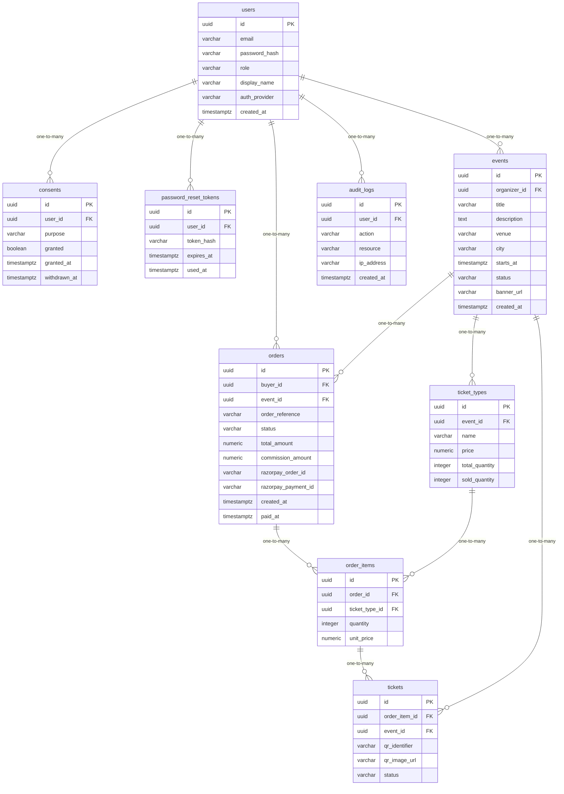

# Data Model

<!-- sdlc:auto:start entities -->
### users

| Field | Type | PK | FK | Nullable |
|---|---|---|---|---|
| id | uuid | True | — | False |
| email | varchar | False | — | False |
| password_hash | varchar | False | — | True |
| role | varchar | False | — | False |
| display_name | varchar | False | — | True |
| auth_provider | varchar | False | — | False |
| created_at | timestamptz | False | — | False |

### consents

| Field | Type | PK | FK | Nullable |
|---|---|---|---|---|
| id | uuid | True | — | False |
| user_id | uuid | False | users.id | False |
| purpose | varchar | False | — | False |
| granted | boolean | False | — | False |
| granted_at | timestamptz | False | — | False |
| withdrawn_at | timestamptz | False | — | True |

### password_reset_tokens

| Field | Type | PK | FK | Nullable |
|---|---|---|---|---|
| id | uuid | True | — | False |
| user_id | uuid | False | users.id | False |
| token_hash | varchar | False | — | False |
| expires_at | timestamptz | False | — | False |
| used_at | timestamptz | False | — | True |

### events

| Field | Type | PK | FK | Nullable |
|---|---|---|---|---|
| id | uuid | True | — | False |
| organizer_id | uuid | False | users.id | False |
| title | varchar | False | — | False |
| description | text | False | — | True |
| venue | varchar | False | — | False |
| city | varchar | False | — | True |
| starts_at | timestamptz | False | — | False |
| status | varchar | False | — | False |
| banner_url | varchar | False | — | True |
| created_at | timestamptz | False | — | False |

### ticket_types

| Field | Type | PK | FK | Nullable |
|---|---|---|---|---|
| id | uuid | True | — | False |
| event_id | uuid | False | events.id | False |
| name | varchar | False | — | False |
| price | numeric | False | — | False |
| total_quantity | integer | False | — | False |
| sold_quantity | integer | False | — | False |

### orders

| Field | Type | PK | FK | Nullable |
|---|---|---|---|---|
| id | uuid | True | — | False |
| buyer_id | uuid | False | users.id | False |
| event_id | uuid | False | events.id | False |
| order_reference | varchar | False | — | False |
| status | varchar | False | — | False |
| total_amount | numeric | False | — | False |
| commission_amount | numeric | False | — | True |
| razorpay_order_id | varchar | False | — | True |
| razorpay_payment_id | varchar | False | — | True |
| created_at | timestamptz | False | — | False |
| paid_at | timestamptz | False | — | True |

### order_items

| Field | Type | PK | FK | Nullable |
|---|---|---|---|---|
| id | uuid | True | — | False |
| order_id | uuid | False | orders.id | False |
| ticket_type_id | uuid | False | ticket_types.id | False |
| quantity | integer | False | — | False |
| unit_price | numeric | False | — | False |

### tickets

| Field | Type | PK | FK | Nullable |
|---|---|---|---|---|
| id | uuid | True | — | False |
| order_item_id | uuid | False | order_items.id | False |
| event_id | uuid | False | events.id | False |
| qr_identifier | varchar | False | — | False |
| qr_image_url | varchar | False | — | True |
| status | varchar | False | — | False |

### audit_logs

| Field | Type | PK | FK | Nullable |
|---|---|---|---|---|
| id | uuid | True | — | False |
| user_id | uuid | False | users.id | True |
| action | varchar | False | — | False |
| resource | varchar | False | — | False |
| ip_address | varchar | False | — | True |
| created_at | timestamptz | False | — | False |
<!-- sdlc:auto:end entities -->

<!-- sdlc:auto:start relationships -->
| Source | Target | Type |
|---|---|---|
| users | consents | one-to-many |
| users | password_reset_tokens | one-to-many |
| users | events | one-to-many |
| events | ticket_types | one-to-many |
| users | orders | one-to-many |
| events | orders | one-to-many |
| orders | order_items | one-to-many |
| ticket_types | order_items | one-to-many |
| order_items | tickets | one-to-many |
| events | tickets | one-to-many |
| users | audit_logs | one-to-many |
<!-- sdlc:auto:end relationships -->

<!-- sdlc:auto:start er-diagram -->

<!-- sdlc:auto:end er-diagram -->
