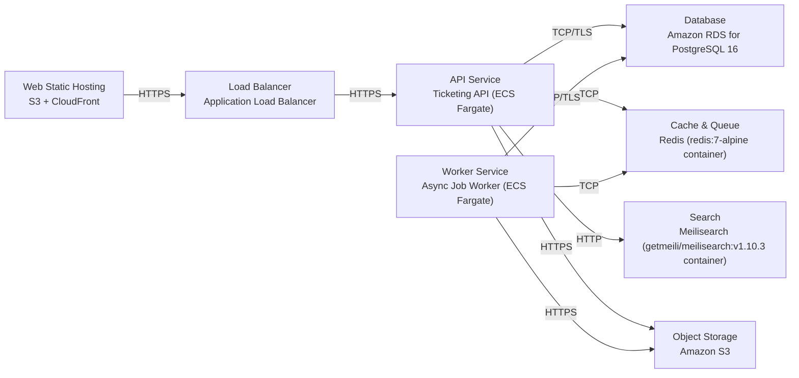

# Deployment Guide

> Maintained by QuorQ AI SDLC. Text between `sdlc:auto` markers is regenerated; anything outside them is yours and is kept.

<!-- sdlc:auto:start how-it-deploys -->
Pushes to `main` run `.github/workflows/deploy.yml`, which builds the API image (if there is a backend) and deploys the SPA to AWS Amplify. Commits touching only `docs/sdlc/**` don't deploy. Deployments can also be started from the platform's Deployment tab.
<!-- sdlc:auto:end how-it-deploys -->

<!-- sdlc:auto:start environments -->
| Name | Service | Runtime | Scaling | Environment |
|---|---|---|---|---|
| Web Static Hosting | S3 + CloudFront | React 19 static build | CDN edge, auto | dev |
| API Service | Ticketing API (ECS Fargate) | Spring Boot 4.1 on JVM 21 | Horizontal, 1-3 tasks | dev |
| Worker Service | Async Job Worker (ECS Fargate) | Spring Boot 4.1 on JVM 21 | Horizontal, 1-2 tasks | dev |
| Database | Amazon RDS for PostgreSQL 16 | PostgreSQL 16 | Single instance (dev) | dev |
| Cache & Queue | Redis (redis:7-alpine container) | Redis 7 | Single node (dev) | dev |
| Search | Meilisearch (getmeili/meilisearch:v1.10.3 container) | Meilisearch v1.10.3 | Single node (dev) | dev |
| Object Storage | Amazon S3 | S3 | Managed | dev |
| Load Balancer | Application Load Balancer | ALB | Managed | dev |
<!-- sdlc:auto:end environments -->

<!-- sdlc:auto:start live -->
_Not deployed yet._
<!-- sdlc:auto:end live -->

<!-- sdlc:auto:start topology -->

<!-- sdlc:auto:end topology -->
